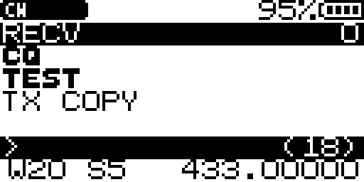

# CW — Morse transceiver overlay App for the F4HWN 8K firmware

<p align="center">
  <a href="https://buymeacoffee.com/busybin"></a>
</p>

CW (Morse) transmit and live decode for the **Quansheng UV-K1 / UV-K5 V3 (PY32F071)** running
F4HWN firmware **with the 8 KiB overlay window**: multitap composer, 4–50 WPM keying,
RSSI-based receive decoder, 131-message history, prosigns.

Unofficial third-party App: not affiliated with, endorsed by, or supported by the F4HWN
firmware project (Armel Fauveau), Quansheng, or the upstream firmware authors.



## Install — two steps, one page

Install everything from the 8K flasher page. Nothing to download here.

### 👉 https://busybin.github.io/uvstudio-8k-flasher/

Desktop Chrome / Edge / Opera (Web Serial), radio plugged into that computer.

1. **Flash the 8K firmware** — *Flash Firmware* → **F4HWN Labs (8K fork) → v6.3.0 · 115 KB** →
   radio in **DFU mode** → *Flash firmware*. Prefer to keep the current firmware? Write the same
   build into a **multiboot slot** (*Firmware Slots* tab) and restore it from the boot menu
   (power on holding **MENU**).
2. **Install this App** — *Apps* → *Application* **CW** → *Target slot* → *Install app*.

Then on the radio: **Apps menu → CW**.

> **The App needs the 8K firmware** (radio shows `F4HWN v6.3.0+8K`). It is linked for the 8 KiB
> overlay window and declares `api_min = 4`, so the stock 4 KiB firmware refuses the package
> (`APP_ERR_ABI`) instead of crashing. Coming from stock firmware, install every App again after
> step 1 — the slot layout changes.
>
> Raw package only if you prefer downloading it: `CW-V18.app.zip` on the
> [latest release](https://github.com/busybin/F4HWN-CW-Morse-App/releases/latest).

## Features

- **Transmit** — multitap text composer (18 chars), `PTT`/`MENU` to send, per-element keying at
  4–50 WPM (unit 24–300 ms, default 100 ms = 12 WPM). Keying mode: **CARR** (carrier on/off,
  decodable by this App) or **TONE/MCW** (carrier held + 700 Hz audio, so ordinary FM radios
  hear a clean CW tone — but this App cannot *receive* it, see below).
- **Receive** — live Morse decode from the RSSI envelope: 8 ms sampling, adaptive floor/peak
  tracking with hysteresis, software squelch (speaker-gated, decoding keeps running), first-mark
  transient trimming, and pruning of isolated all-T/E noise bursts.
- **Message box** — 4 visible rows, sent messages prefixed `TX ` (normal weight), received bold,
  automatic wrapping, **131 messages of history** (fits only in the 8 KiB window).
- **Prosigns** — `F` latch + digit inserts a prosign. Defaults:

  | `F+1` | `F+2` | `F+3` | `F+4` | `F+5` | `F+6` | `F+7` | `F+8` | `F+9` |
  | --- | --- | --- | --- | --- | --- | --- | --- | --- |
  | CQ | DE | UR | RST | R | TU | 73 | AR | SK |

  Each slot holds up to 5 characters. Edit them **per radio** from the flasher page's
  **Prosigns** tab — it rewrites the table in the installed App in place, no reinstall.
- **Config** — WPM, squelch level and CARR/TONE mode persist in the slot header sector; survive
  App re-install on the 8K firmware.
- **Layout** — all 7 screen rows used: status bar → live preview → 4-row message box → compose
  row → `W12 S5` + frequency.

## Key map

| Key | Function |
| --- | --- |
| `PTT` / `MENU` | send the composed message (empty or busy → `BUSY` popup) |
| `UP` / `DOWN` | WPM − / + (unit 24–300 ms ⇒ 50–4 WPM) |
| Side key 1 (raw 18) | squelch +1 · Side key 2 (raw 17) squelch −1 |
| `EXIT` | press twice within 1.5 s to leave (config saved on exit) |
| `0`–`9` | multitap text input (`0` = backspace) |
| `*` | space |
| `F` short | latch — next digit inserts a prosign |
| `F` double | clear compose buffer + message box |
| `F` long | toggle CARR / TONE (popup + 1 kHz beep) |

Popups: `BUSY` (receiving or empty buffer) / `FULL` (input full) auto-hide after 1.5 s and are
accompanied by a 300 Hz double deny beep. Beeps are RX-safe by construction (they use
`prepare_tone + play_tone_raw + tones_off_rx`), and nothing sounds while receiving.

## How to use

1. **Open** the App: radio → Apps menu → **CW**.
2. **Compose**: `0`–`9` multitap (e.g. tap `2` repeatedly for `A`/`B`/`C`/`2`); `*` = space,
   `0` = backspace.
3. **Insert a prosign**: press `F`, then a digit — `F+1` = CQ … `F+9` = SK (see the table above).
4. **Send**: `PTT` or `MENU` (empty or busy → `BUSY`).
5. **Receive**: incoming Morse decodes live from the RSSI envelope. Received text is bold, sent
   text is prefixed `TX `.

## Receiving — the one hard limitation

**Only CARR can be decoded.** The decoder works on the RSSI envelope, i.e. it needs the carrier
itself to be switched on and off. If the other station transmits **TONE/MCW** (carrier held,
700 Hz audio keyed) the envelope is flat and you see a single `T`. Make sure both ends run CARR.

Decoding chain (all in `cw_v16.c`): 8 ms `rssi_dbm()` → EMA smoothing → noise-floor EMA tracked
only while idle → squelch opens at `floor+6+2·level` dB, closes −4 dB → dot/dash = mark ≥ 2 units
→ 2 units = character gap, 5 units = word gap → burst leading mark trimmed by one unit
(TX→RX transient) → 384 ms blanking after your own transmission → isolated all-T/E bursts pruned.

## Building

```bash
./build.sh            # needs arm-none-eabi-gcc 13.x on PATH (or TC=/path/to/bin)
```

Produces the packaged `.app` image (FAP1). Link script `app.ld` targets the 8 KiB overlay at VMA
`0x20000280`; `app_api.h` is the firmware's overlay ABI header. The App declares
**`api_min = 4`** (the 8K fork's API level: upstream level 3 plus `uid_get` at offset 396).
Budget: **code 5324 B + bss 2828 B = 8152 / 8192 B** — 40 bytes left, so check the linker report
before adding features.

Version 18 uses the level 3 services: `blit_page(8)` for the screen (a whole-screen blit without
the blocking K5Viewer frame that `blit_full` sends — that frame overran the 8K stack and crashed
the radio when a viewer was connected; the viewer is fed from the idle loop instead),
`tx_prepare()` for keying (no 10 ms unshaped carrier burst before the first mark), the resident
`append_u32` formatter and the resident divider `uidivmod`.

## Licence & attribution

Apache-2.0 (see [LICENSE](LICENSE)). This App is derived from
[lu-meiagui/CW-F4HWN-App](https://github.com/lu-meiagui/CW-F4HWN-App) (itself based on armel's
Beacon overlay App, Apache-2.0); the upstream repository declares no license, so this repository
grants none for its copyrighted parts — only the modifications contributed here are Apache-2.0.
Details in [NOTICE.md](NOTICE.md).
